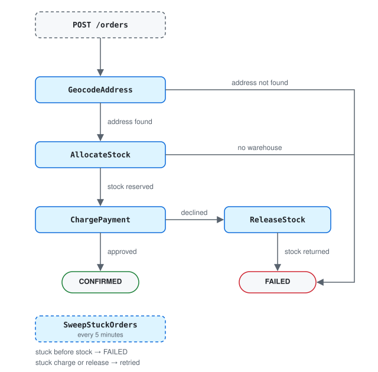

# E-commerce Orders

An order management API for an e-commerce platform, built as an experiment
on a hypothetical scenario ([full scenario](docs/scenario.md)).

A customer places an order with a shipping address and a list of items, paid
with their saved card. The service finds the closest warehouse that can ship
every item, reserves the stock and charges the card. The order is accepted
right away and processed in the background, and the customer can follow its
status until it is confirmed or failed.

The goal of this project is to get hands-on with a few software engineering
concepts and tools:

- Go
- Postgres
- [River](https://riverqueue.com/) with transactional enqueueing
- Saga with compensation
- Ports and adapters (hexagonal architecture)
- AI-assisted development
- Idempotency
- Concurrency-safe operations

## Notes

- [How it works](docs/how-it-works.md)
- [Order API](docs/decisions/order-api.md)
- [Code architecture](docs/decisions/code-architecture.md)
- [Requirements](docs/decisions/requirements.md)
- [Running it](docs/running.md)
